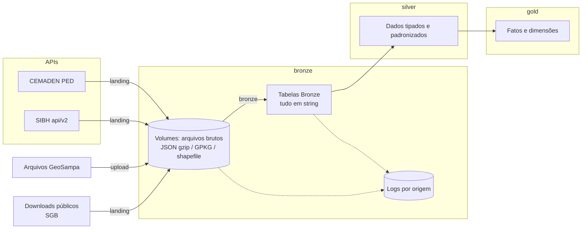
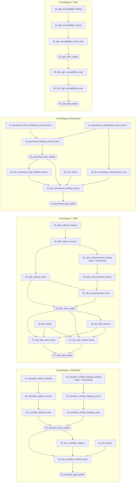

# ChuvaSegura: FIAP GS2 2TSCPV 2026

Pipeline de dados em Databricks que junta **chuva**, **nível de rios e córregos** e **histórico de alagamentos** da cidade de São Paulo (IBGE 3550308). O objetivo é cruzar as medições com as ocorrências de alagamento.

| Fonte | O que traz | Acesso |
|---|---|---|
| **CEMADEN** (API PED) | Cadastro de estações e leituras de chuva da rede CEMADEN | Login na SGAA (token) |
| **SIBH / SP Águas** | Cadastro de estações e medições de chuva e nível das demais instituições (SP Águas, SAISP, SABESP…) | API pública |
| **GeoSampa** | Ocorrências de alagamento, deslizamento, inundação e queda de árvore, além das subprefeituras | Arquivos baixados e enviados ao volume |
| **SGB / CPRM** | Carta de suscetibilidade a movimentos de massa e inundações do município (IPT/CPRM, 2015): áreas de suscetibilidade, bacias contribuintes e padrões de relevo | Download público (RIGEO) |

## Arquitetura

Tudo fica no catálogo `fiap_analytics` do Unity Catalog, em três camadas:



- **Landing:** baixa das APIs e dos portais e grava os arquivos no volume, exatamente como vieram, com um manifesto de controle (contagem e SHA256). Dos pacotes grandes (o da carta do SGB tem quase 1 GB), só os arquivos usados são lidos, por requisições HTTP Range.
- **Bronze:** carrega os arquivos em tabelas Delta, com todas as colunas como texto e colunas de controle (`_source_file`, `_batch_id`, `_ingested_at`...). Campos novos da API vão para `_rescued_data`.
- **Silver:** dados tipados, padronizados e relacionados.
- **Gold:** modelo dimensional para análise.

Situação atual:

| Fonte | Landing | Bronze | Silver | Gold |
|---|:-:|:-:|:-:|:-:|
| CEMADEN | ✅ | ✅ | ✅ | ✅ |
| SIBH | ✅ | ✅ | ✅ | ✅ |
| GeoSampa | ✅ | ✅ | ✅ | ✅ |
| SGB | ✅ | ✅ | ✅ | ✅ |

## Estrutura do repositório

O número no início de cada arquivo indica a ordem de execução dentro da fonte.

```
jobs/                                             # definição dos jobs do Databricks (YAML)
├── chuvasegura_cemaden.job.yml
├── chuvasegura_geosampa.job.yml
├── chuvasegura_sgb.job.yml
└── chuvasegura_sibh.job.yml
src/
├── common/
│   ├── arquivos.py                               # downloads com novas tentativas e extração de zips remotos (HTTP Range)
│   ├── conversoes.py                             # conversões de texto (datas, números, fuso) usadas nas Silvers
│   ├── data_quality.py                           # regras e execução das etapas de qualidade de dados
│   ├── geo.py                                    # shapefile, GeoPackage, WKB, UTM 23S <-> lat/lon, área e centroide
│   └── ingestion_log.py                          # log de ingestão padrão (módulo Python)
├── shared/
│   └── transformations/gold/
│       └── 00_dim_tempo.sql                      # dimensão de tempo compartilhada pelas fatos
├── cemaden/
│   ├── ingestion/
│   │   ├── 01_cemaden_stations_landing.py
│   │   └── 01_cemaden_rainfall_readings_landing.py
│   ├── quality/
│   │   ├── 03_cemaden_silver_quality.py
│   │   └── 05_cemaden_gold_quality.py
│   └── transformations/
│       ├── bronze/
│       │   ├── 02_cemaden_stations_bronze.py
│       │   └── 02_cemaden_rainfall_readings_bronze.py
│       ├── silver/
│       │   ├── 03_cemaden_stations_silver.py
│       │   └── 03_cemaden_rainfall_readings_silver.py
│       └── gold/
│           ├── 04_dim_cemaden_stations.sql
│           └── 05_fact_cemaden_rainfall_hourly.sql
├── sibh/
│   ├── ingestion/
│   │   ├── 01_sibh_stations_landing.py
│   │   └── 03_sibh_measurements_landing.py
│   ├── quality/
│   │   ├── 05_sibh_silver_quality.py
│   │   └── 07_sibh_gold_quality.py
│   └── transformations/
│       ├── bronze/
│       │   ├── 02_sibh_stations_bronze.py
│       │   └── 04_sibh_measurements_bronze.py
│       ├── silver/
│       │   ├── 05_sibh_stations_silver.py
│       │   └── 05_sibh_measurements_silver.py
│       └── gold/
│           ├── 06_dim_sibh_sensors.sql
│           ├── 07_fact_sibh_rainfall_hourly.sql
│           └── 07_fact_sibh_level_hourly.sql
├── geosampa/
│   ├── ingestion/
│   │   ├── 01_geosampa_subprefecture_area_bronze.sql
│   │   └── 01_geosampa_history_flooding_events_bronze.py
│   ├── quality/
│   │   ├── 02_geosampa_silver_quality.py
│   │   └── 04_geosampa_gold_quality.py
│   └── transformations/
│       ├── silver/
│       │   └── 02_geosampa_flooding_events_silver.sql
│       └── gold/
│           ├── 03_dim_geosampa_subprefecture_area.sql
│           ├── 03_dim_geosampa_type_flooding_events.sql
│           └── 04_fact_geosampa_flooding_events.sql
└── sgb/
    ├── ingestion/
    │   └── 01_sgb_susceptibility_landing.py
    ├── quality/
    │   ├── 03_sgb_silver_quality.py
    │   └── 05_sgb_gold_quality.py
    └── transformations/
        ├── bronze/
        │   └── 02_sgb_susceptibility_bronze.py
        ├── silver/
        │   └── 03_sgb_susceptibility_areas_silver.py
        └── gold/
            ├── 04_dim_sgb_susceptibility_class.sql
            └── 05_dim_sgb_susceptibility_areas.sql
```

Os notebooks estão no formato de código-fonte do Databricks (`.py` e `.sql` começando com `Databricks notebook source`). O Databricks os abre como notebooks normais, com as células separadas.

## Pré-requisitos

1. **Workspace Databricks com Unity Catalog** e compute serverless ou um Databricks Runtime recente. O notebook da Gold do GeoSampa usa variáveis de sessão SQL e scripting SQL (`BEGIN … END`).
2. **Repositório clonado como Git folder** (*Workspace → Create → Git folder*). Os notebooks importam os módulos de `src/common/` (log de ingestão, qualidade de dados e conversões) a partir da pasta do próprio notebook.
3. **Catálogo e schemas:**

   ```sql
   CREATE CATALOG IF NOT EXISTS fiap_analytics;
   CREATE SCHEMA IF NOT EXISTS fiap_analytics.bronze;
   CREATE SCHEMA IF NOT EXISTS fiap_analytics.silver;
   CREATE SCHEMA IF NOT EXISTS fiap_analytics.gold;
   ```

   Os volumes e as tabelas de log são criados pelos próprios notebooks.

4. **Credenciais do CEMADEN** num secret scope chamado `cemaden`, com as chaves `ped_email` e `ped_password` da conta cadastrada na SGAA/PED:

   ```bash
   databricks secrets create-scope cemaden
   databricks secrets put-secret cemaden ped_email
   databricks secrets put-secret cemaden ped_password
   ```

5. **Arquivos do GeoSampa:**
   - baixe os arquivos de ocorrências em GeoPackage (`.gpkg`), soltos ou dentro de um `.zip`;
   - mantenha o ano no nome do arquivo (por exemplo, `alagamentos_2024.gpkg`), porque é dele que a carga tira o ano de origem;
   - envie os arquivos para o volume:

   ```sql
   CREATE VOLUME IF NOT EXISTS fiap_analytics.bronze.geosampa_history_flooding_events;
   ```

   Depois, faça o upload em *Catalog → fiap_analytics → bronze → Volumes → geosampa_history_flooding_events → Upload*.

## Ordem de execução

### CEMADEN

O cadastro de estações e as leituras de chuva seguem em paralelo até a Silver. Daí em diante, a qualidade da Silver barra a Gold.

| # | Notebook | Widgets |
|---|---|---|
| 1 | `01_cemaden_stations_landing` | `codibge` (3550308), `tipoestacao` (vazio = todos), `formato` (JSON) |
| 2 | `02_cemaden_stations_bronze` | `snapshot_date`: `pending` (padrão), `latest`, `all` ou `AAAA-MM-DD` |
| 1 | `01_cemaden_rainfall_readings_landing` | `modo`: `backfill` ou `incremental`; `mes_inicio` (202001, mínimo); `mes_fim` (vazio = último mês fechado); `forcar_reprocesso`: `nao`/`sim` |
| 2 | `02_cemaden_rainfall_readings_bronze` | (sem widgets: carrega os meses pendentes segundo o log) |
| 3 | `03_cemaden_stations_silver` | (sem widgets: recria a Silver a partir de todos os snapshots) |
| 3 | `03_cemaden_rainfall_readings_silver` | `window`: `pending` (padrão: meses recarregados na Bronze), `all` ou `AAAAMM` |
| 3 | `03_cemaden_silver_quality` (pasta `quality/`) | (sem widgets) |
| 4 | `04_dim_cemaden_stations` | (sem widgets) |
| 5 | `05_fact_cemaden_rainfall_hourly` | (sem widgets: recarrega os meses novos ou alterados) |
| 5 | `05_cemaden_gold_quality` (pasta `quality/`) | (sem widgets) |

- **Período:** só leituras a partir de janeiro de 2020, o mesmo início do SIBH. O histórico desde 2014 deixava a Bronze com cerca de 17 milhões de linhas. A landing não baixa meses anteriores (um `mes_inicio` menor é trocado por 202001), e a Bronze remove os que já estavam na tabela. A Silver e a Gold acompanham sozinhas, porque removem os meses que saíram da camada anterior. Os arquivos brutos antigos continuam no volume e podem ser apagados à mão (`ano=2014` a `ano=2019`).
- A PED aceita 12 chamadas por minuto, então o primeiro backfill desde 2020 leva algumas horas. Se parar no meio, basta rodar de novo: o notebook continua de onde parou.
- Os cadastros (`*_stations_*`) são snapshots diários: rodar no mesmo dia substitui o snapshot do dia.
- **Silver das estações:** uma linha por estação, com a versão do snapshot mais recente em que ela aparece. Estações que saíram do cadastro continuam na tabela (`fl_no_cadastro_atual = false`), para que as leituras antigas tenham estação.
- **Silver das leituras:** `datahora` da fonte está em UTC e vira `dt_hr_leitura_utc`; `dt_leitura`, `nr_hora` e `cod_dim_data` são calculados no fuso de São Paulo. `valor` vira `nr_chuva_mm` (chuva em mm no intervalo da leitura). Leituras duplicadas (mesma estação, sensor e data e hora) ficam uma só, a da carga mais recente.
- **Gold:** a fato `fact_cemaden_rainfall_hourly` tem uma linha por estação, sensor, dia e hora (fuso de São Paulo), com a chuva acumulada, a maior leitura e o número de leituras da hora. Hora sem leitura não tem linha. A carga é incremental por mês, com o mesmo controle de assinatura da fato do GeoSampa.

### SIBH

Os passos são sequenciais, porque a coleta das medições usa o cadastro da Bronze para escolher os sensores.

| # | Notebook | Widgets |
|---|---|---|
| 1 | `01_sibh_stations_landing` | `api_url`, `codibge_check` (3550308) |
| 2 | `02_sibh_stations_bronze` | `snapshot_date`: `pending` (padrão), `latest`, `all` ou `AAAA-MM-DD` |
| 3 | `03_sibh_measurements_landing` | `mode`: `probe`, `backfill` ou `incremental`; `group_type` (`minute`); `min_month` (2020-01); `excluded_owners` (CEMADEN); `min_interval_s` (1.0); `force` |
| 4 | `04_sibh_measurements_bronze` | `window`: `pending` (padrão), `all` ou `AAAA-MM` |
| 5 | `05_sibh_stations_silver` | (sem widgets: recria a Silver a partir de todos os snapshots) |
| 5 | `05_sibh_measurements_silver` | `window`: `pending` (padrão: meses recarregados na Bronze), `all` ou `AAAA-MM` |
| 5 | `05_sibh_silver_quality` (pasta `quality/`) | (sem widgets) |
| 6 | `06_dim_sibh_sensors` | (sem widgets) |
| 7 | `07_fact_sibh_rainfall_hourly` e `07_fact_sibh_level_hourly` | (sem widgets: recarregam os meses novos ou alterados) |
| 7 | `07_sibh_gold_quality` (pasta `quality/`) | (sem widgets) |

- Os sensores do CEMADEN ficam de fora do SIBH por padrão, porque já vêm pela PED.
- O modo `probe` faz duas chamadas de teste e mostra a resposta da API sem gravar nada.
- **Silver dos sensores:** uma linha por sensor (`id` do cadastro). No SIBH, chuva e nível de um mesmo local têm `id` diferentes e o mesmo `cod_estacao`. Só a capital e os tipos 2 (`Chuva`) e 1 (`Nível`), com a versão do snapshot mais recente em que o sensor aparece.
- **Silver das medições:** `date` da fonte está em UTC e vira `dt_hr_medicao_utc`; `dt_medicao`, `nr_hora` e `cod_dim_data` ficam no fuso de São Paulo. `value` vira `nr_valor` (chuva em mm por medição, ou nível na unidade da fonte), e `dc_grandeza` diz qual dos dois é. Medições duplicadas (mesmo sensor e data e hora) ficam uma só.
- **Gold:** uma dimensão de sensores e duas fatos por sensor, dia e hora (fuso de São Paulo): `fact_sibh_rainfall_hourly` (chuva somada, maior medição e número de medições) e `fact_sibh_level_hourly` (nível médio, mínimo, máximo e último da hora). As duas têm carga incremental por mês.

### Dimensão de tempo (compartilhada)

`00_dim_tempo` cria e mantém a `fiap_analytics.gold.dim_tempo`: um dia por linha, de 2010 até o fim do ano seguinte, com chave `COD_DIM_TEMPO` no formato `yyyyMMdd`. É a única dimensão compartilhada entre as fontes. Toda fato do projeto usa essa chave, e fatos com granularidade menor que o dia (chuva por hora, por exemplo) guardam a hora na própria fato. O notebook roda no job `ChuvaSegura`, antes da fato do GeoSampa, e cada execução só acrescenta os dias que faltam.

### GeoSampa

| # | Notebook | Depende de |
|---|---|---|
| 1 | `01_geosampa_subprefecture_area_bronze` | — |
| 1 | `01_geosampa_history_flooding_events_bronze` | arquivos no volume |
| 2 | `02_geosampa_flooding_events_silver` | os dois passos 1 |
| 2 | `02_geosampa_silver_quality` (pasta `quality/`) | Silver |
| 3 | `03_dim_geosampa_subprefecture_area` | subprefeituras (Bronze) |
| 3 | `03_dim_geosampa_type_flooding_events` | qualidade da Silver |
| 4 | `04_fact_geosampa_flooding_events` | qualidade da Silver, as duas dimensões e a `dim_tempo` |
| 4 | `04_geosampa_gold_quality` (pasta `quality/`) | fato |

- Arquivos que já foram carregados (mesmo SHA256) são pulados.
- Um arquivo por ano no volume. Para corrigir um ano, troque o arquivo no volume pela versão nova e rode o job: a carga grava a versão nova e remove as linhas da anterior. Se houver dois arquivos do mesmo ano, a carga para e pede para deixar só um.
- A Silver converte a geometria (POINT ou POINT Z em WKB, conforme o ano do arquivo; SIRGAS 2000 / UTM 23S, EPSG 31983) em coordenadas UTM e em latitude e longitude. A conversão é uma UDF Python registrada no próprio notebook, e a última célula confere quantos pontos ficaram sem coordenada ou fora da área de São Paulo.
- A Gold recarrega só os anos de origem novos ou alterados.
- **Modelo da Gold (GeoSampa):** estrela com a fato `fact_geosampa_flooding_events` e as dimensões `dim_tempo`, `dim_geosampa_type_flooding_events` e `dim_geosampa_subprefecture_area`. Cada ocorrência é identificada por `NUM_ANO_ORIGEM` + `NUM_ID_OCORRENCIA` (número da ocorrência no arquivo do ano; no arquivo de 2026 ele vem na coluna `primaryindex`). Tipo ou subprefeitura não encontrados vão para o membro `-1` (não informado), então a fato nunca tem chave nula. As chaves estrangeiras são declaradas (informativas no Unity Catalog) e a fato usa liquid clustering por data e subprefeitura.

### SGB (carta de suscetibilidade)

| # | Notebook | Widgets |
|---|---|---|
| 1 | `01_sgb_susceptibility_landing` | `url` (pacote SIG da carta no RIGEO); `forcar`: `nao`/`sim` |
| 2 | `02_sgb_susceptibility_bronze` | `recarregar`: `nao`/`sim` |
| 3 | `03_sgb_susceptibility_areas_silver` | (sem widgets: recria a Silver a partir da Bronze) |
| 3 | `03_sgb_silver_quality` (pasta `quality/`) | (sem widgets) |
| 4 | `04_dim_sgb_susceptibility_class` | (sem widgets) |
| 5 | `05_dim_sgb_susceptibility_areas` | (sem widgets) |
| 5 | `05_sgb_gold_quality` (pasta `quality/`) | (sem widgets) |

- **Fonte:** *Carta de suscetibilidade a movimentos gravitacionais de massa e inundações: município de São Paulo - SP* (IPT/CPRM, 2015, escala 1:75.000), [registro no RIGEO](https://rigeo.sgb.gov.br/handle/doc/15216). O pacote SIG tem cerca de 970 MB, quase tudo fotos de campo. A landing lê do zip publicado só a pasta `12.Suscetibilidade` e a `04.PadrõesDeRelevo` (cerca de 30 MB) e grava esses arquivos, sem alteração, num zip por versão.
- **Carta estática:** se o pacote não mudou no RIGEO (mesmo ETag, tamanho e data), a landing não baixa nada e registra `SEM_DADOS`, e a Bronze não recarrega.
- **Camadas** (`cd_camada`): `inundacao` (1.166 polígonos), `bacia_inundacao` (802 bacias de drenagem que contribuem para as inundações; vão além do município, por todo o Alto Tietê), `enxurrada` (37), `movimento_massa` (2.370), `corrida_massa` (6) e `relevo` (211 polígonos de padrões de relevo). Classes `Alta`, `Média` e `Baixa` (grau 3, 2 e 1); enxurrada e corrida de massa não têm graduação.
- **Geometria:** a fonte está em SIRGAS 2000 / UTM 23S (EPSG 31983). A Silver grava a geometria em SIRGAS 2000 geográfico (EPSG 4674, longitude e latitude), o padrão das fontes geoespaciais do projeto, e calcula em UTM a área, o centroide e o envelope. As conversões estão em `src/common/geo.py`, em Python puro, e rodam no driver. A área calculada bate com a `Shape_Area` da fonte com diferença abaixo de 10⁻¹¹.
- **Declividade e relevo:** a declividade de cada classe (por exemplo, inundação Alta em declividades abaixo de 2° e movimento de massa Alta acima de 25°) e as características predominantes vêm dos quadros-síntese da carta, transcritos na dimensão de classes. O relevo entra como camada própria. O modelo digital de elevação e a declividade em raster ficam fora do projeto.
- **Áreas publicadas:** no movimento de massa, a soma dos polígonos de cada classe bate com o quadro-síntese (100,1, 231,2 e 1.196,2 km²). Na inundação, a soma (69,3, 88,0 e 138,8 km²) passa da área do quadro (52,0, 66,2 e 113,1 km²). A diferença está no próprio arquivo, por isso a qualidade compara com a `Shape_Area`.
- **Modelo da Gold (SGB):** `dim_sgb_susceptibility_class` (camada e classe, com grau, declividade, características e área do quadro-síntese) e `dim_sgb_susceptibility_areas` (dimensão espacial, uma linha por polígono, com a classe, a área, o centroide, o envelope e a geometria). As duas têm o membro `-1`. As áreas são a referência para o cruzamento com as ocorrências do GeoSampa: uma ocorrência pode cair em mais de uma área da mesma camada, e nesse caso vale o maior grau.

## Jobs e workflows

Cada fonte tem um job, e a definição de cada um fica em `jobs/`, no formato YAML dos jobs do Databricks (`resources.jobs`). Separar por fonte faz com que uma falha numa API não trave as outras.

| Arquivo | Job | Agenda (America/Sao_Paulo) | Situação |
|---|---|---|---|
| `jobs/chuvasegura_geosampa.job.yml` | `ChuvaSegura` | todo dia às 09:00:30 | ativo |
| `jobs/chuvasegura_cemaden.job.yml` | `ChuvaSegura - CEMADEN` | todo dia às 07:00 | ativo |
| `jobs/chuvasegura_sibh.job.yml` | `ChuvaSegura - SIBH` | todo dia às 07:30 | ativo |
| `jobs/chuvasegura_sgb.job.yml` | `ChuvaSegura - SGB` | dia 1 de cada mês às 06:00 | ativo |



Todos os jobs:
- rodam em compute serverless (ambiente 6), com fila habilitada;
- apontam para os notebooks no Git folder `/Workspace/Users/rm562679@fiap.com.br/FIAP-GS2-2TSCPV-2026`. Se o repositório estiver clonado em outro lugar, troque esse prefixo em todos os arquivos de `jobs/`.

**Antes de ativar CEMADEN e SIBH:**
1. Rode uma vez, manualmente, a carga do histórico com o modo `backfill`:
   - CEMADEN: `01_cemaden_rainfall_readings_landing` com `modo = backfill`;
   - SIBH: `03_sibh_measurements_landing` com `mode = backfill`.
2. Rode as Bronzes correspondentes.
3. Mude `pause_status` para `UNPAUSED`, ou ative a agenda na interface.

O incremental diário cobre o mês atual e completa os meses parciais.

**Como aplicar os YAMLs:**
- **Job que já existe** (`ChuvaSegura`): troque o caminho de cada tarefa pelo do YAML. Em *Workflows → ChuvaSegura*, abra cada tarefa e edite o campo *Path*.
- **Job novo:** crie em *Workflows → Create job*, com as tarefas, dependências, parâmetros (`base_parameters`) e agenda do arquivo.
- **Com a Databricks CLI:** os arquivos já estão no formato de *resources* dos Databricks Asset Bundles. Para usar `databricks bundle deploy`, é preciso um `databricks.yml` na raiz que inclua `jobs/*.job.yml`. Para o bundle passar a gerenciar o `ChuvaSegura` já existente em vez de criar outro, use `databricks bundle deployment bind ChuvaSegura <job_id>`.

Sempre que um notebook mudar de nome ou de pasta, atualize o YAML no mesmo PR.

## Logs de ingestão e meses parciais

Cada origem tem a sua tabela de log, todas no mesmo formato, definido em `src/common/ingestion_log.py`:

- `fiap_analytics.bronze.cemaden_ingestion_log`
- `fiap_analytics.bronze.sibh_ingestion_log`
- `fiap_analytics.bronze.geosampa_ingestion_log`
- `fiap_analytics.bronze.sgb_ingestion_log`

Colunas: `batch_id, fonte, etapa, janela, status, registros, paginas, duplicados, arquivo, sha256, duracao_s, iniciado_em, finalizado_em, mensagem`.

| Status | Significado |
|---|---|
| `SUCESSO` | Carga completa |
| `PARCIAL` | Mês baixado antes de fechar. Será baixado de novo |
| `SEM_DADOS` | Período completo e sem registros |
| `FALHA` | Erro. A mensagem fica em `mensagem` e a próxima execução tenta de novo |

**Meses parciais:**
- Nas leituras do CEMADEN e nas medições do SIBH, um mês só é dado como completo se foi baixado **pelo menos 3 dias depois de terminar**, para pegar leituras que chegam atrasadas. Até lá ele fica `PARCIAL`.
- O incremental baixa de novo o mês atual, o mês anterior enquanto não estiver completo e qualquer mês que tenha ficado parcial.
- O backfill pula só os meses completos.

Exemplo de consulta:

```sql
SELECT fonte, etapa, janela, status, registros, finalizado_em, mensagem
FROM fiap_analytics.bronze.cemaden_ingestion_log
ORDER BY finalizado_em DESC
LIMIT 50;
```

## Qualidade de dados

As etapas de qualidade usam o módulo `src/common/data_quality.py` e rodam como tarefas do job, depois da Silver e depois da Gold. O GeoSampa é a referência: as outras fontes vão seguir o mesmo padrão.

- **Regra:** uma consulta SQL que devolve `falhas` (linhas que violam a regra) e `total` (linhas avaliadas). A regra passa quando `falhas / total` não passa do `limite`. Com limite 0, nenhuma falha é aceita.
- **Severidade:**
  - `ERRO`: se falhar, a tarefa para e o job não segue. A Gold nunca é carregada a partir de uma Silver reprovada.
  - `AVISO`: só registra.
- **Regra que não consegue rodar** (tabela inexistente, SQL inválido) conta como falha, nunca como sucesso.
- **Regras prontas:** `nao_vazia`, `nao_nulo`, `condicao` (expressão verdadeira nas linhas que violam a regra), `unico`, `existe_em` (integridade referencial) e `consulta` (SQL livre).
- **Resultados:** ficam na tabela de qualidade de cada origem (`fiap_analytics.bronze.geosampa_data_quality_log`, `fiap_analytics.bronze.cemaden_data_quality_log`, `fiap_analytics.bronze.sibh_data_quality_log` e `fiap_analytics.bronze.sgb_data_quality_log`), uma linha por regra e execução, com tabela, regra, severidade, status (`SUCESSO`/`FALHA`), falhas, total, percentual e limite.

Regras do GeoSampa:

| Etapa | ERRO (para o job) | AVISO (só registra) |
|---|---|---|
| Silver | tabela não vazia; mesmas linhas da Bronze; ano e `nr_id_ocorrencia` preenchidos e únicos por ano; data preenchida e entre 2010 e hoje; SRID 31983; ponto dentro da área de São Paulo | `name` repetido no ano; data fora do ano do arquivo; mais de 1% sem coordenada ou sem subprefeitura; mais de 5% do tipo "Outros" |
| Gold | fato não vazia; mesmas linhas da Silver por ano; ocorrência única; chaves existentes na `dim_tempo` e nas dimensões; ponto dentro da área; chaves únicas e membro `-1` nas dimensões; `dim_tempo` sem chave repetida nem dia faltando | mais de 1% das ocorrências com subprefeitura `-1`; ocorrências com tipo `-1` |

Regras do CEMADEN:

| Etapa | ERRO (para o job) | AVISO (só registra) |
|---|---|---|
| Silver | estações: tabela não vazia, código único, latitude e longitude preenchidas e dentro da área de São Paulo; leituras: tabela não vazia, uma linha por chave distinta da Bronze, estação, sensor e data e hora preenchidos, data entre 2020 e agora, chuva não negativa | mais de 1% das leituras com data e hora fora do mês pedido à API (confere a premissa de UTC); mais de 1% sem valor; leituras acima de 50 mm; mais de 1% de leituras de estações fora do cadastro |
| Gold | fato não vazia; uma linha por estação, sensor, dia e hora; leituras e chuva iguais às da Silver em cada mês; chaves existentes na `dim_tempo` e na dimensão de estações; chuva da hora não negativa; chaves únicas e membro `-1` na dimensão | mais de 1% das horas com estação `-1`; horas acima de 120 mm |

Regras do SIBH:

| Etapa | ERRO (para o job) | AVISO (só registra) |
|---|---|---|
| Silver | sensores: tabela não vazia, sensor único, grandeza, latitude e longitude preenchidas e dentro da área de São Paulo; medições: tabela não vazia, uma linha por chave distinta da Bronze, sensor, grandeza e data e hora preenchidos, data entre 2010 e agora, chuva não negativa | mais de 1% das medições com data e hora fora do mês pedido à API (confere a premissa de UTC); mais de 1% sem valor; chuva acima de 50 mm numa medição; mais de 1% de medições de sensores fora do cadastro |
| Gold | as duas fatos não vazias, com uma linha por sensor, dia e hora, medições iguais às da Silver em cada mês e chaves existentes na `dim_tempo` e na dimensão de sensores; chuva igual à da Silver em cada mês e não negativa; nível mínimo, médio e máximo coerentes; chaves únicas e membro `-1` na dimensão | mais de 1% das horas com sensor `-1`; horas de chuva acima de 120 mm; sensor de chuva na fato de nível |

Regras do SGB:

| Etapa | ERRO (para o job) | AVISO (só registra) |
|---|---|---|
| Silver | tabela não vazia; mesmas feições da Bronze; as seis camadas presentes; feição única na camada; classe preenchida e, nas camadas graduadas, Alta, Média ou Baixa; geometria de origem em EPSG 31983 e preenchida; área maior que zero e igual à `Shape_Area` da fonte (0,01%); feições dentro da área de São Paulo (menos as bacias contribuintes); movimento de massa e relevo cobrindo a área do município (2%) | camada desconhecida; área de cada classe de movimento de massa diferente do quadro-síntese (1%) |
| Gold | dimensões não vazias; chaves únicas e membro `-1`; grau coerente com a classe; áreas e feições iguais às da Silver em cada camada; classe existente na dimensão de classes e nenhuma área com classe `-1`; geometria preenchida; centroide dentro do envelope | classe graduada sem características do quadro-síntese |

Para incluir uma regra, acrescente-a à lista `regras` do notebook da etapa. Exemplo de consulta aos resultados:

```sql
SELECT executado_em, etapa, tabela, regra, severidade, status, falhas, total, percentual
FROM fiap_analytics.bronze.geosampa_data_quality_log
WHERE status = 'FALHA'
ORDER BY executado_em DESC;
```

## Tabelas geradas

| Camada | Tabela | Conteúdo |
|---|---|---|
| bronze | `cemaden_stations` | Snapshots diários do cadastro de estações do CEMADEN |
| bronze | `cemaden_rainfall_readings` | Leituras de chuva do CEMADEN a partir de 2020, uma fatia por mês (`_window`) |
| bronze | `sibh_stations` | Snapshots diários do cadastro de estações do SIBH (estado inteiro) |
| bronze | `sibh_measurements` | Medições de chuva e nível do SIBH na capital, uma fatia por mês |
| bronze | `geosampa_history_flooding_events` | Ocorrências do GeoSampa, com a geometria em WKB |
| bronze | `geosampa_subprefecture_area` | Subprefeituras e agrupamentos (Anexo IX) |
| bronze | `geosampa_data_quality_log` | Resultados das regras de qualidade do GeoSampa |
| bronze | `cemaden_data_quality_log` | Resultados das regras de qualidade do CEMADEN |
| bronze | `sibh_data_quality_log` | Resultados das regras de qualidade do SIBH |
| bronze | `sgb_susceptibility_areas` | Feições da carta de suscetibilidade do SGB, uma linha por feição de cada camada, com a geometria em WKB (EPSG 31983) |
| bronze | `sgb_data_quality_log` | Resultados das regras de qualidade do SGB |
| silver | `sibh_stations` | Sensores de chuva e nível do SIBH na capital, uma linha por sensor, tipados |
| silver | `sibh_measurements` | Medições de chuva e nível tipadas e sem duplicidade, com data e hora em UTC e dia e hora no fuso de São Paulo |
| silver | `cemaden_stations` | Estações do CEMADEN no município, uma linha por estação, tipadas |
| silver | `cemaden_rainfall_readings` | Leituras de chuva tipadas e sem duplicidade, com data e hora em UTC e dia e hora no fuso de São Paulo |
| silver | `sgb_susceptibility_areas` | Áreas da carta de suscetibilidade, com camada e classe padronizadas, geometria em EPSG 4674, área, centroide e envelope |
| silver | `geosampa_flooding_events` | Ocorrências com identificador (`nr_id_ocorrencia`), data, tipo e subprefeitura padronizados e localização (`nr_x_utm`, `nr_y_utm`, `nr_latitude`, `nr_longitude`, `geom_wkb`) |
| gold | `dim_tempo` | Dimensão de tempo diária, compartilhada por todas as fatos |
| gold | `dim_cemaden_stations` | Dimensão de estações do CEMADEN, com o membro `-1` (não informado) |
| gold | `fact_cemaden_rainfall_hourly` | Fato de chuva por estação, sensor, dia e hora |
| gold | `dim_sibh_sensors` | Dimensão de sensores do SIBH (chuva e nível), com o membro `-1` (não informado) |
| gold | `fact_sibh_rainfall_hourly` | Fato de chuva por sensor, dia e hora |
| gold | `fact_sibh_level_hourly` | Fato de nível por sensor, dia e hora (médio, mínimo, máximo e último) |
| gold | `dim_geosampa_subprefecture_area` | Dimensão de subprefeituras, com o membro `-1` (não informado) |
| gold | `dim_geosampa_type_flooding_events` | Dimensão de tipos de ocorrência, com o membro `-1` (não informado) |
| gold | `fact_geosampa_flooding_events` | Fato de ocorrências (uma linha por ocorrência) por data, tipo e subprefeitura, com latitude e longitude |
| gold | `dim_sgb_susceptibility_class` | Dimensão de classes da carta do SGB (camada e classe, com grau, declividade e características do quadro-síntese), com o membro `-1` |
| gold | `dim_sgb_susceptibility_areas` | Dimensão espacial das áreas da carta do SGB, uma linha por polígono, com classe, área, centroide, envelope e geometria |

## Desenvolvimento

- **Módulos de `src/common`:** depois de alterar `ingestion_log.py`, `data_quality.py`, `conversoes.py`, `geo.py` ou `arquivos.py`, reinicie o Python do notebook (*Run → Restart Python*) para recarregar o módulo.
- **Fluxo de trabalho:** cada mudança vai numa branch própria e entra na `main` por pull request.

## Próximos passos

- Cruzamento da chuva e do nível com as ocorrências do GeoSampa.

## Fontes dos dados

- **CEMADEN:** dados da rede observacional do Centro Nacional de Monitoramento e Alertas de Desastres Naturais (CEMADEN/MCTI), via API PED.
- **SIBH:** Sistema de Informações Hidrológicas, Agência de Águas do Estado de São Paulo (SP Águas).
- **GeoSampa:** Prefeitura de São Paulo. Subprefeituras conforme o Anexo IX (ata 41/14).
- **SGB:** Serviço Geológico do Brasil (SGB/CPRM) e Instituto de Pesquisas Tecnológicas (IPT). *Carta de suscetibilidade a movimentos gravitacionais de massa e inundações: município de São Paulo - SP*, 2015, escala 1:75.000. Disponível no RIGEO.
