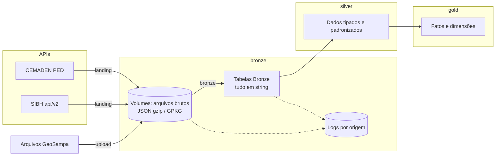

# ChuvaSegura: FIAP GS2 2TSCPV 2026

Pipeline de dados em Databricks que junta **chuva**, **nível de rios e córregos** e **histórico de alagamentos** da cidade de São Paulo (IBGE 3550308). O objetivo é cruzar as medições com as ocorrências de alagamento.

| Fonte | O que traz | Acesso |
|---|---|---|
| **CEMADEN** (API PED) | Cadastro de estações e leituras de chuva da rede CEMADEN | Login na SGAA (token) |
| **SIBH / SP Águas** | Cadastro de estações e medições de chuva e nível das demais instituições (SP Águas, SAISP, SABESP…) | API pública |
| **GeoSampa** | Ocorrências de alagamento, deslizamento, inundação e queda de árvore, além das subprefeituras | Arquivos baixados e enviados ao volume |

## Arquitetura

Tudo fica no catálogo `fiap_analytics` do Unity Catalog, em três camadas:



- **Landing:** baixa das APIs e grava os arquivos no volume, exatamente como vieram, com um manifesto de controle (contagem e SHA256).
- **Bronze:** carrega os arquivos em tabelas Delta, com todas as colunas como texto e colunas de controle (`_source_file`, `_batch_id`, `_ingested_at`...). Campos novos da API vão para `_rescued_data`.
- **Silver:** dados tipados, padronizados e relacionados.
- **Gold:** modelo dimensional para análise.

Situação atual:

| Fonte | Landing | Bronze | Silver | Gold |
|---|:-:|:-:|:-:|:-:|
| CEMADEN | ✅ | ✅ | ⏳ | ⏳ |
| SIBH | ✅ | ✅ | ⏳ | ⏳ |
| GeoSampa | ✅ | ✅ | ✅ | ✅ |

## Estrutura do repositório

O número no início de cada arquivo indica a ordem de execução dentro da fonte.

```
src/
├── common/
│   └── ingestion_log.py                          # log de ingestão padrão (módulo Python)
├── cemaden/
│   ├── ingestion/
│   │   ├── 01_cemaden_stations_landing.py
│   │   └── 01_cemaden_rainfall_readings_landing.py
│   └── transformations/bronze/
│       ├── 02_cemaden_stations_bronze.py
│       └── 02_cemaden_rainfall_readings_bronze.py
├── sibh/
│   ├── ingestion/
│   │   ├── 01_sibh_stations_landing.py
│   │   └── 03_sibh_measurements_landing.py
│   └── transformations/bronze/
│       ├── 02_sibh_stations_bronze.py
│       └── 04_sibh_measurements_bronze.py
└── geosampa/
    ├── ingestion/
    │   ├── 01_geosampa_subprefecture_area_bronze.sql
    │   └── 01_geosampa_history_flooding_events_bronze.py
    └── transformations/
        ├── silver/
        │   └── 02_geosampa_flooding_events_silver.sql
        └── gold/
            ├── 03_dim_geosampa_subprefecture_area.sql
            ├── 03_dim_geosampa_type_flooding_events.sql
            └── 04_fact_geosampa_flooding_events.sql
```

Os notebooks estão no formato de código-fonte do Databricks (`.py` e `.sql` começando com `Databricks notebook source`). O Databricks os abre como notebooks normais, com as células separadas.

## Pré-requisitos

1. **Workspace Databricks com Unity Catalog** e compute serverless ou um Databricks Runtime recente. O notebook da Gold do GeoSampa usa variáveis de sessão SQL e scripting SQL (`BEGIN … END`).
2. **Repositório clonado como Git folder** (*Workspace → Create → Git folder*). Os notebooks importam `src/common/ingestion_log.py` a partir da pasta do próprio notebook.
3. **Catálogo e schemas:**

   ```sql
   CREATE CATALOG IF NOT EXISTS fiap_analytics;
   CREATE SCHEMA IF NOT EXISTS fiap_analytics.bronze;
   CREATE SCHEMA IF NOT EXISTS fiap_analytics.silver;
   CREATE SCHEMA IF NOT EXISTS fiap_analytics.gold;
   ```

   Os volumes e as tabelas de log são criados pelos próprios notebooks.

4. **Credenciais do CEMADEN** num secret scope chamado `cemaden`, com as chaves `ped_email` e `ped_password` da conta cadastrada na SGAA/PED:

   ```bash
   databricks secrets create-scope cemaden
   databricks secrets put-secret cemaden ped_email
   databricks secrets put-secret cemaden ped_password
   ```

5. **Arquivos do GeoSampa:**
   - baixe os arquivos de ocorrências em GeoPackage (`.gpkg`), soltos ou dentro de um `.zip`;
   - mantenha o ano no nome do arquivo (por exemplo, `alagamentos_2024.gpkg`), porque é dele que a carga tira o ano de origem;
   - envie os arquivos para o volume:

   ```sql
   CREATE VOLUME IF NOT EXISTS fiap_analytics.bronze.geosampa_history_flooding_events;
   ```

   Depois, faça o upload em *Catalog → fiap_analytics → bronze → Volumes → geosampa_history_flooding_events → Upload*.

## Ordem de execução

### CEMADEN

São dois fluxos independentes. Cada um tem a landing e depois a Bronze.

| # | Notebook | Widgets |
|---|---|---|
| 1 | `01_cemaden_stations_landing` | `codibge` (3550308), `tipoestacao` (vazio = todos), `formato` (JSON) |
| 2 | `02_cemaden_stations_bronze` | `snapshot_date`: `pending` (padrão), `latest`, `all` ou `AAAA-MM-DD` |
| 1 | `01_cemaden_rainfall_readings_landing` | `modo`: `backfill` ou `incremental`; `mes_inicio` (201401); `mes_fim` (vazio = último mês fechado); `forcar_reprocesso`: `nao`/`sim` |
| 2 | `02_cemaden_rainfall_readings_bronze` | (sem widgets: carrega os meses pendentes segundo o log) |

- A PED aceita 12 chamadas por minuto, então o primeiro backfill desde 2014 leva horas. Se parar no meio, basta rodar de novo: o notebook continua de onde parou.
- Os cadastros (`*_stations_*`) são snapshots diários: rodar no mesmo dia substitui o snapshot do dia.

### SIBH

Os passos são sequenciais, porque a coleta das medições usa o cadastro da Bronze para escolher os sensores.

| # | Notebook | Widgets |
|---|---|---|
| 1 | `01_sibh_stations_landing` | `api_url`, `codibge_check` (3550308) |
| 2 | `02_sibh_stations_bronze` | `snapshot_date`: `pending` (padrão), `latest`, `all` ou `AAAA-MM-DD` |
| 3 | `03_sibh_measurements_landing` | `mode`: `probe`, `backfill` ou `incremental`; `group_type` (`minute`); `min_month` (2020-01); `excluded_owners` (CEMADEN); `min_interval_s` (1.0); `force` |
| 4 | `04_sibh_measurements_bronze` | `window`: `pending` (padrão), `all` ou `AAAA-MM` |

- Os sensores do CEMADEN ficam de fora do SIBH por padrão, porque já vêm pela PED.
- O modo `probe` faz duas chamadas de teste e mostra a resposta da API sem gravar nada.

### GeoSampa

| # | Notebook | Depende de |
|---|---|---|
| 1 | `01_geosampa_subprefecture_area_bronze` | — |
| 1 | `01_geosampa_history_flooding_events_bronze` | arquivos no volume |
| 2 | `02_geosampa_flooding_events_silver` | os dois passos 1 |
| 3 | `03_dim_geosampa_subprefecture_area` | subprefeituras (Bronze) |
| 3 | `03_dim_geosampa_type_flooding_events` | Silver |
| 4 | `04_fact_geosampa_flooding_events` | Silver e as duas dimensões |

- Arquivos que já foram carregados (mesmo SHA256) são pulados.
- A Gold recarrega só os anos de origem novos ou alterados.

### Jobs sugeridos

Os jobs são criados na interface do Databricks (*Workflows → Create job*), com uma tarefa por notebook na ordem acima.

| Job | Tarefas | Agenda sugerida |
|---|---|---|
| CEMADEN | stations landing → stations bronze; readings landing (`modo = incremental`) → readings bronze | diária |
| SIBH | stations landing → stations bronze → measurements landing (`mode = incremental`) → measurements bronze | diária |
| GeoSampa | 01 → 02 → 03 → 04 | quando chegar um arquivo novo |

O backfill inicial de CEMADEN e SIBH deve ser rodado manualmente uma vez, com o modo `backfill`, antes de agendar o incremental.

## Logs de ingestão e meses parciais

Cada origem tem a sua tabela de log, todas no mesmo formato, definido em `src/common/ingestion_log.py`:

- `fiap_analytics.bronze.cemaden_ingestion_log`
- `fiap_analytics.bronze.sibh_ingestion_log`
- `fiap_analytics.bronze.geosampa_ingestion_log`

Colunas: `batch_id, fonte, etapa, janela, status, registros, paginas, duplicados, arquivo, sha256, duracao_s, iniciado_em, finalizado_em, mensagem`.

| Status | Significado |
|---|---|
| `SUCESSO` | Carga completa |
| `PARCIAL` | Mês baixado antes de fechar. Será baixado de novo |
| `SEM_DADOS` | Período completo e sem registros |
| `FALHA` | Erro. A mensagem fica em `mensagem` e a próxima execução tenta de novo |

**Meses parciais:**
- Nas leituras do CEMADEN e nas medições do SIBH, um mês só é dado como completo se foi baixado **pelo menos 3 dias depois de terminar**, para pegar leituras que chegam atrasadas. Até lá ele fica `PARCIAL`.
- O incremental baixa de novo o mês atual, o mês anterior enquanto não estiver completo e qualquer mês que tenha ficado parcial.
- O backfill pula só os meses completos.

Exemplo de consulta:

```sql
SELECT fonte, etapa, janela, status, registros, finalizado_em, mensagem
FROM fiap_analytics.bronze.cemaden_ingestion_log
ORDER BY finalizado_em DESC
LIMIT 50;
```

## Tabelas geradas

| Camada | Tabela | Conteúdo |
|---|---|---|
| bronze | `cemaden_stations` | Snapshots diários do cadastro de estações do CEMADEN |
| bronze | `cemaden_rainfall_readings` | Leituras de chuva do CEMADEN, uma fatia por mês (`_window`) |
| bronze | `sibh_stations` | Snapshots diários do cadastro de estações do SIBH (estado inteiro) |
| bronze | `sibh_measurements` | Medições de chuva e nível do SIBH na capital, uma fatia por mês |
| bronze | `geosampa_history_flooding_events` | Ocorrências do GeoSampa, com a geometria em WKB |
| bronze | `geosampa_subprefecture_area` | Subprefeituras e agrupamentos (Anexo IX) |
| silver | `fact_geosampa_flooding_events` | Ocorrências com data, tipo e subprefeitura padronizados |
| gold | `dim_geosampa_subprefecture_area` | Dimensão de subprefeituras |
| gold | `dim_geosampa_type_flooding_events` | Dimensão de tipos de ocorrência |
| gold | `fact_geosampa_flooding_events` | Fato de ocorrências por data, tipo e subprefeitura |

## Desenvolvimento

- **Módulo de log:** depois de alterar `src/common/ingestion_log.py`, reinicie o Python do notebook (*Run → Restart Python*) para recarregar o módulo.
- **Fluxo de trabalho:** cada mudança vai numa branch própria e entra na `main` por pull request.

## Próximos passos

- Silver e Gold do CEMADEN e do SIBH, para cruzar chuva e nível com as ocorrências do GeoSampa.

## Fontes dos dados

- **CEMADEN:** dados da rede observacional do Centro Nacional de Monitoramento e Alertas de Desastres Naturais (CEMADEN/MCTI), via API PED.
- **SIBH:** Sistema de Informações Hidrológicas, Agência de Águas do Estado de São Paulo (SP Águas).
- **GeoSampa:** Prefeitura de São Paulo. Subprefeituras conforme o Anexo IX (ata 41/14).
