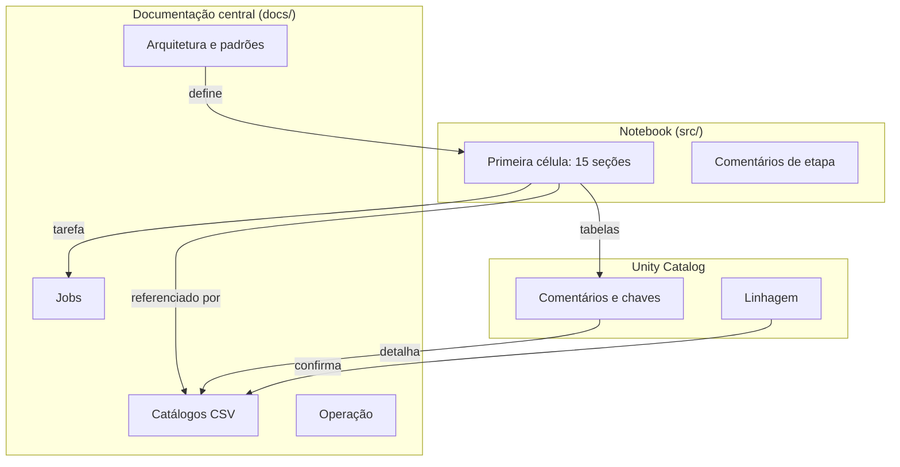

# Documento de arquitetura da documentação

| Campo | Valor |
|---|---|
| Projeto | ChuvaSegura (FIAP GS2 2TSCPV 2026) |
| Documento | Arquitetura e padrão oficial de documentação dos notebooks |
| Versão | 1.0 |
| Data | 2026-11-16 |
| Responsável | juniorOnData |
| Situação | Proposto para adoção |

## 1. Objetivo

Estabelecer um padrão único de documentação para os notebooks, jobs e tabelas do projeto, de forma que qualquer pessoa da equipe consiga entender, a partir do repositório, a finalidade, o funcionamento, as dependências, as regras de negócio e os resultados de cada notebook, e consiga operar, reprocessar e auditar o pipeline.

## 2. Escopo

Fazem parte do escopo:

1. Os 17 notebooks de `src/` (Python e SQL), das fontes CEMADEN, SIBH e GeoSampa e da dimensão compartilhada de tempo.
2. Os módulos Python compartilhados de `src/common/` (log de ingestão e qualidade de dados).
3. Os três jobs definidos em `jobs/`.
4. Todas as tabelas e volumes do catálogo `fiap_analytics`.

Ficam fora do escopo a documentação de painéis e relatórios que consomem a Gold, ainda não desenvolvidos.

## 3. Premissas

| Premissa | Situação |
|---|---|
| O repositório Git é a fonte oficial da documentação | Adotada |
| Os notebooks ficam no formato de código fonte do Databricks (`.py` e `.sql`) | Adotada desde o PR #9 |
| O workspace usa Unity Catalog, com o catálogo `fiap_analytics` e os schemas `bronze`, `silver` e `gold` | Confirmada pelo código |
| Os notebooks são executados a partir de um Git folder no workspace | Confirmada pelos caminhos dos jobs |
| O compute é serverless (ambiente 6) | Confirmada pela definição dos jobs |
| Os dados das três fontes são públicos | A confirmar com os termos de uso de cada fonte |
| Responsável funcional, SLA e permissões por grupo | A definir pela equipe |

## 4. O que está implementado e o que é recomendação

A tabela separa os recursos presentes no projeto dos que são recomendação de evolução. Recurso nativo é o que a plataforma oferece pronto; desenvolvido é o que a equipe construiu.

| Recurso | Tipo | Situação no projeto |
|---|---|---|
| Unity Catalog (catálogo, schemas, tabelas, volumes) | Nativo | Em uso |
| Delta Lake | Nativo | Em uso em todas as tabelas |
| Volumes do Unity Catalog para arquivos brutos | Nativo | Em uso nas landings e no GeoSampa |
| Comentários de tabela e de coluna (`COMMENT`) | Nativo | Em uso na maior parte das tabelas da Silver e da Gold |
| Chaves primárias e estrangeiras informativas | Nativo | Em uso na Gold (PR #14) |
| Liquid clustering | Nativo | Em uso na fato do GeoSampa |
| Linhagem de dados do Unity Catalog | Nativo | Disponível automaticamente para leituras e gravações em tabelas do Unity Catalog |
| Lakeflow Jobs | Nativo | Três jobs, definidos em YAML no repositório |
| Git folders | Nativo | Em uso (caminho dos jobs) |
| Secrets | Nativo | Em uso (scope `cemaden`) |
| Declarative Automation Bundles (antigos Databricks Asset Bundles) | Nativo | Não implantado: os YAMLs já estão no formato de recursos, mas não há `databricks.yml` |
| Tags e classificação de dados no Unity Catalog | Nativo | Não configurado (recomendação) |
| Notificações, retentativas e timeout nos jobs | Nativo | Não configurado (recomendação) |
| Log de ingestão por origem (`src/common/ingestion_log.py`) | Desenvolvido | Em uso nas três fontes |
| Etapas de qualidade de dados (`src/common/data_quality.py`) | Desenvolvido | Em uso no GeoSampa |
| Template de notebook, catálogos e checklist (esta documentação) | Desenvolvido | Em adoção (PR #15) |
| Scala e R | Linguagens | Não usadas hoje; o padrão já as contempla |

## 5. Arquitetura da documentação

A documentação tem dois níveis, com papéis distintos:

| Nível | Conteúdo | Formato | Quem mantém |
|---|---|---|---|
| Central (`docs/`) | Padrões, arquitetura, fluxo, catálogos, dicionário de dados, jobs, operação, histórico | Markdown e CSV | Responsável técnico do projeto |
| Notebook (primeira célula) | As 15 seções do template, específicas do notebook | Markdown dentro do notebook | Quem altera o notebook, no mesmo PR |
| Código | Comentários de etapa `[LING] Enn` e comentários que explicam decisões técnicas | Comentários | Quem altera o código |
| Plataforma | Comentários de tabela e coluna, chaves, linhagem | Metadados do Unity Catalog | Gerados pelos próprios notebooks |

Para evitar repetição:

1. As colunas das tabelas ficam só no [dicionário de dados](../02_catalogos/dicionario_de_dados.csv) e nos comentários das tabelas. O notebook informa a tabela de saída, a granularidade e a chave.
2. As regras de negócio têm o detalhe no notebook que as aplica e um resumo no [catálogo de regras](../02_catalogos/catalogo_regras_de_negocio.csv), que funciona como índice.
3. Os padrões de nome e de governança ficam só nos documentos centrais.
4. A sequência de tarefas de cada job fica na documentação do job e no YAML; o notebook só indica a tarefa que o executa.



## 6. Organização de diretórios do repositório

```
.github/
  pull_request_template.md     Checklist de documentação em todo PR
docs/                          Documentação central (ver docs/README.md)
jobs/                          Definição dos jobs (Lakeflow Jobs) em YAML
src/
  common/                      Módulos Python compartilhados (log de ingestão, qualidade de dados)
  shared/                      Notebooks compartilhados entre fontes (dim_tempo)
  <fonte>/                     cemaden, sibh, geosampa
    ingestion/                 Landing (APIs para volume) e cargas diretas na Bronze
    transformations/bronze/    Carga dos volumes para tabelas Bronze
    transformations/silver/    Tipagem, padronização e regras de negócio
    transformations/gold/      Modelo dimensional (dimensões e fatos)
    quality/                   Etapas de qualidade de dados
README.md                      Visão geral, pré-requisitos e ordem de execução
```

## 7. Convenções e padrões

| Tema | Documento |
|---|---|
| Nomes de notebooks, jobs, tarefas, tabelas, colunas, parâmetros e regras | [Padrão de nomenclatura](padrao_de_nomenclatura.md) |
| Template de notebook e convenção para várias linguagens | [Template oficial](../05_templates/template_notebook.md) |
| Template de job | [Template de job](../05_templates/template_job.md) |
| Identificação, versionamento, linhagem e controle de alterações | [Governança e rastreabilidade](governanca_e_rastreabilidade.md) |

### Valores padronizados dos campos de identificação

| Campo | Valores | Critério |
|---|---|---|
| Camada | Landing, Bronze, Silver, Gold, Qualidade | Camada em que o notebook grava |
| Status | Desenvolvimento, Homologação, Produção, Descontinuado | Desenvolvimento: ainda não roda em job. Homologação: roda em job pausado ou em validação. Produção: roda em job ativo. Descontinuado: mantido só para consulta |
| Criticidade | Alta, Média, Baixa | Alta: grava a Gold, uma dimensão compartilhada ou bloqueia a Gold (qualidade). Média: grava Landing, Bronze ou Silver, reprocessável a partir da origem. Baixa: notebook de apoio ou consulta |
| Versão | MAJOR.MINOR | MINOR a cada PR que altera o notebook; MAJOR quando a saída muda de forma incompatível (nome, granularidade ou chave) |

A criticidade atribuída a cada notebook é uma proposta pelos critérios acima e deve ser confirmada pelo responsável funcional.

## 8. Governança

O detalhe está em [governança e rastreabilidade](governanca_e_rastreabilidade.md). Em resumo:

1. Toda mudança entra por pull request, com o checklist preenchido.
2. Cada notebook tem um identificador único que não muda, mesmo se o arquivo for renomeado.
3. A rastreabilidade combina a linhagem nativa do Unity Catalog com as colunas de origem (`_source_*`, `_batch_id`) e os logs de ingestão e de qualidade.

## 9. Responsabilidades

| Papel | Responsabilidade | Atribuição atual |
|---|---|---|
| Responsável técnico | Manter o código, a primeira célula do notebook e os catálogos; aprovar PRs | juniorOnData |
| Responsável funcional | Validar objetivo, regras de negócio, criticidade, SLA e classificação dos dados | A definir |
| Revisor do PR | Conferir código e documentação pelo checklist de conformidade | A definir (outro membro da equipe) |
| Operador | Acompanhar os jobs, os logs e os resultados de qualidade; executar reprocessamentos | A definir |

## 10. Critérios de conformidade

Um notebook é considerado documentado quando atende ao [checklist de conformidade](../06_conformidade/checklist_conformidade.md). Os critérios mínimos por estágio são:

| Estágio | Critérios obrigatórios |
|---|---|
| Homologação | 15 seções presentes; seções 01, 02, 04, 05, 06, 07, 08, 10 e 12 preenchidas; comentário de etapa em toda célula de código; linha no catálogo de notebooks |
| Produção | Todos os itens de homologação; seções 09, 11, 13 e 14 preenchidas; regras no catálogo de regras; colunas no dicionário de dados; tarefa no job e no catálogo de tarefas; histórico atualizado no PR |

## 11. Visão consolidada e recomendações

O padrão foi aplicado a todos os 17 notebooks do projeto neste PR. Para que ele se torne o padrão oficial, recomenda-se:

1. Tornar o checklist do PR obrigatório na revisão: um PR que altera notebook sem atualizar a seção 15 e os catálogos não é aprovado.
2. Definir o responsável funcional, o SLA e a classificação de cada conjunto de dados, hoje marcados como "A definir".
3. Configurar notificações de falha nos três jobs e avaliar retentativas nas tarefas que chamam APIs externas.
4. Implantar os Declarative Automation Bundles (`databricks.yml`), para que a definição dos jobs no repositório seja a mesma do workspace.
5. Aplicar tags do Unity Catalog com a classificação e o domínio de cada tabela.

O cronograma dessas ações está no [plano de implantação](../07_implantacao/plano_de_implantacao.md).
