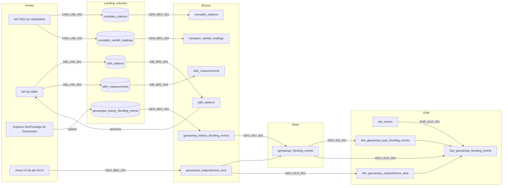

# Fluxo de processamento

O projeto segue a arquitetura Medallion. Todos os objetos ficam no catálogo `fiap_analytics` do Unity Catalog.

| Camada | Schema | Papel | Padrão de escrita |
|---|---|---|---|
| Landing | Volumes em `bronze` | Arquivos exatamente como vieram da fonte, com manifesto de controle (contagem e SHA256) | Um arquivo por janela (dia de coleta ou mês), sobrescrito na recoleta |
| Bronze | `bronze` | Tabelas Delta com as colunas da origem em texto e colunas de controle (`_source_*`, `_batch_id`, `_ingested_at`, `_rescued_data`) | Substituição da fatia (`replaceWhere`) ou `append` com controle de versão |
| Silver | `silver` | Dados tipados, padronizados e relacionados, com as regras de negócio aplicadas | Recriação completa (`CREATE OR REPLACE`) |
| Gold | `gold` | Modelo dimensional (fatos e dimensões) para análise | `MERGE` nas dimensões; `DELETE` e `INSERT` por ano na fato |
| Controle | `bronze` | Logs de ingestão e resultados de qualidade, uma tabela por origem | `append` |

## Fluxo completo

A Silver e a Gold de CEMADEN e SIBH ainda não foram desenvolvidas. O GeoSampa é o pipeline de referência para elas.

## Sequência por fonte

### GeoSampa (pipeline completo)

| Ordem | Notebook | ID | Entrada | Saída |
|---|---|---|---|---|
| 1 | `01_geosampa_subprefecture_area_bronze` | GEO_BRZ_001 | Anexo IX (no código) | `bronze.geosampa_subprefecture_area` |
| 1 | `01_geosampa_history_flooding_events_bronze` | GEO_BRZ_002 | Volume `geosampa_history_flooding_events` | `bronze.geosampa_history_flooding_events` |
| 2 | `02_geosampa_flooding_events_silver` | GEO_SLV_001 | As duas tabelas Bronze | `silver.geosampa_flooding_events` |
| 2 | `02_geosampa_silver_quality` | GEO_DQ_001 | Silver e Bronze | `bronze.geosampa_data_quality_log`; bloqueia a Gold se reprovar |
| 3 | `03_dim_geosampa_subprefecture_area` | GEO_GLD_001 | `bronze.geosampa_subprefecture_area` | `gold.dim_geosampa_subprefecture_area` |
| 3 | `03_dim_geosampa_type_flooding_events` | GEO_GLD_002 | Silver | `gold.dim_geosampa_type_flooding_events` |
| 0 | `00_dim_tempo` | SHR_GLD_001 | Calendário gerado | `gold.dim_tempo` |
| 4 | `04_fact_geosampa_flooding_events` | GEO_GLD_003 | Silver e as três dimensões | `gold.fact_geosampa_flooding_events` |
| 4 | `04_geosampa_gold_quality` | GEO_DQ_002 | Gold e Silver | `bronze.geosampa_data_quality_log` |

### CEMADEN (até a Bronze)

| Ordem | Notebook | ID | Entrada | Saída |
|---|---|---|---|---|
| 1 | `01_cemaden_stations_landing` | CEM_LND_001 | API PED (cadastro) | Volume `cemaden_stations` |
| 2 | `02_cemaden_stations_bronze` | CEM_BRZ_001 | Volume `cemaden_stations` | `bronze.cemaden_stations` |
| 1 | `01_cemaden_rainfall_readings_landing` | CEM_LND_002 | API PED (leituras) | Volume `cemaden_rainfall_readings` |
| 2 | `02_cemaden_rainfall_readings_bronze` | CEM_BRZ_002 | Volume e log | `bronze.cemaden_rainfall_readings` |

### SIBH (até a Bronze)

| Ordem | Notebook | ID | Entrada | Saída |
|---|---|---|---|---|
| 1 | `01_sibh_stations_landing` | SIB_LND_001 | API do SIBH (cadastro) | Volume `sibh_stations` |
| 2 | `02_sibh_stations_bronze` | SIB_BRZ_001 | Volume `sibh_stations` | `bronze.sibh_stations` |
| 3 | `03_sibh_measurements_landing` | SIB_LND_002 | API do SIBH (medições) e `bronze.sibh_stations` | Volume `sibh_measurements` |
| 4 | `04_sibh_measurements_bronze` | SIB_BRZ_002 | Volume `sibh_measurements` | `bronze.sibh_measurements` |

## Controle de execução

| Mecanismo | Onde | Para que serve |
|---|---|---|
| Manifesto | Ao lado de cada arquivo da landing | Contagem, SHA256 e campos; a Bronze só carrega arquivos com manifesto e confere a contagem |
| Log de ingestão | `bronze.<origem>_ingestion_log` | Situação de cada janela (`SUCESSO`, `PARCIAL`, `SEM_DADOS`, `FALHA`); checkpoint das coletas do CEMADEN |
| Resultados de qualidade | `bronze.geosampa_data_quality_log` | Resultado de cada regra em cada execução |
| Colunas de linhagem | `_source_file`, `_source_sha256`, `_batch_id`, `_landing_batch_id` | Ligar cada linha ao arquivo e à execução que a gerou |
