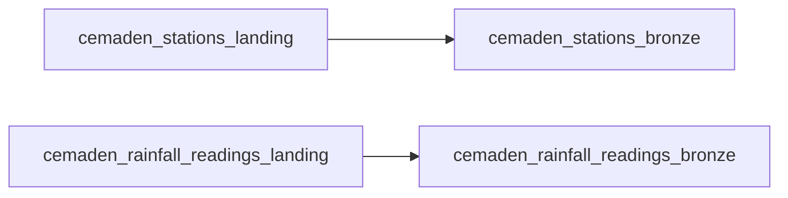

# JOB_CHUVASEGURA_CEMADEN

## 1. Identificação

| Campo | Valor |
|---|---|
| Identificador | JOB_CHUVASEGURA_CEMADEN |
| Nome exibido | `ChuvaSegura - CEMADEN` |
| Arquivo de definição | `jobs/chuvasegura_cemaden.job.yml` |
| Responsável técnico | juniorOnData |
| Responsável funcional | A definir |
| Situação | Pausado até o backfill inicial |

## 2. Objetivo

Coletar diariamente o cadastro de estações e as leituras de chuva da rede CEMADEN no município de São Paulo pela API PED e carregá-los na Bronze.

## 3. Frequência e horário

| Campo | Valor |
|---|---|
| Agenda (Quartz) | `0 0 7 * * ?` |
| Fuso horário | America/Sao_Paulo |
| Horário | Todo dia às 07:00 |
| Situação da agenda | Pausada |
| Fila | Habilitada |

## 4. Tarefas executadas

| Ordem | Tarefa | Notebook | Depende de | Parâmetros |
|---|---|---|---|---|
| 1 | `cemaden_stations_landing` | CEM_LND_001 `01_cemaden_stations_landing` | Nenhuma | Padrão do notebook |
| 2 | `cemaden_stations_bronze` | CEM_BRZ_001 `02_cemaden_stations_bronze` | `cemaden_stations_landing` | `snapshot_date = pending` |
| 1 | `cemaden_rainfall_readings_landing` | CEM_LND_002 `01_cemaden_rainfall_readings_landing` | Nenhuma | `modo = incremental` |
| 2 | `cemaden_rainfall_readings_bronze` | CEM_BRZ_002 `02_cemaden_rainfall_readings_bronze` | `cemaden_rainfall_readings_landing` | Nenhum |

## 5. Sequência de execução

Os dois fluxos são independentes e rodam em paralelo.

## 6. Políticas de execução

| Política | Configuração |
|---|---|
| Retentativas | Não configurado na tarefa. Os notebooks já repetem chamadas com falha (até 5 por chamada e 3 por mês) |
| Timeout | Não configurado. Recomendação: timeout na landing de leituras, que depende do limite de 12 chamadas por minuto da PED |
| Notificações | Não configurado. Recomendação: notificação de falha |
| Compute | Serverless, ambiente 6, `PERFORMANCE_OPTIMIZED` |

## 7. Critérios de sucesso e falha

O job é bem sucedido quando as quatro tarefas terminam sem erro. A landing de leituras termina com erro se algum mês ficou com `FALHA` no `cemaden_ingestion_log`; a Bronze de leituras termina com erro se algum mês não pôde ser carregado.

## 8. Estratégia de reprocessamento

Antes de ativar a agenda, rodar manualmente `01_cemaden_rainfall_readings_landing` com `modo = backfill` e depois a Bronze. Rodar o job de novo continua de onde parou, porque o log serve de checkpoint. Ver [reprocessamento](../04_operacao/reprocessamento.md).

## 9. Histórico

| Data | Responsável | Descrição |
|---|---|---|
| 2026-11-16 | juniorOnData | Criação do job, com a agenda pausada (PR #10) |
| 2026-11-16 | juniorOnData | Documentação no padrão oficial (PR #15) |
