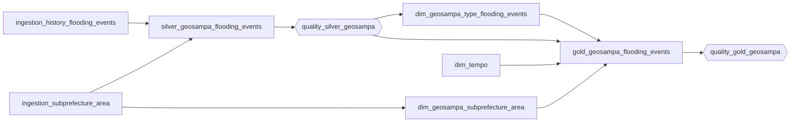

# JOB_CHUVASEGURA_GEOSAMPA

## 1. Identificação

| Campo | Valor |
|---|---|
| Identificador | JOB_CHUVASEGURA_GEOSAMPA |
| Nome exibido | `ChuvaSegura` |
| Arquivo de definição | `jobs/chuvasegura_geosampa.job.yml` |
| Responsável técnico | juniorOnData |
| Responsável funcional | A definir |
| Situação | Ativo |

## 2. Objetivo

Carregar as ocorrências do GeoSampa da Bronze até a Gold, validar a Silver e a Gold com as regras de qualidade e manter a `dim_tempo` compartilhada. O resultado é a fato `fiap_analytics.gold.fact_geosampa_flooding_events` com as suas dimensões, pronta para análise.

## 3. Frequência e horário

| Campo | Valor |
|---|---|
| Agenda (Quartz) | `30 0 9 * * ?` |
| Fuso horário | America/Sao_Paulo |
| Horário | Todo dia às 09:00:30 |
| Situação da agenda | Ativa |
| Fila | Habilitada |

A execução diária é segura mesmo sem arquivo novo: a Bronze pula arquivos já carregados e a fato só recarrega os anos que mudaram.

## 4. Tarefas executadas

| Ordem | Tarefa | Notebook | Depende de | Parâmetros |
|---|---|---|---|---|
| 1 | `ingestion_history_flooding_events` | GEO_BRZ_002 `01_geosampa_history_flooding_events_bronze` | Nenhuma | Nenhum |
| 1 | `ingestion_subprefecture_area` | GEO_BRZ_001 `01_geosampa_subprefecture_area_bronze` | Nenhuma | Nenhum |
| 1 | `dim_tempo` | SHR_GLD_001 `00_dim_tempo` | Nenhuma | Nenhum |
| 2 | `silver_geosampa_flooding_events` | GEO_SLV_001 `02_geosampa_flooding_events_silver` | As duas ingestões | Nenhum |
| 2 | `dim_geosampa_subprefecture_area` | GEO_GLD_001 `03_dim_geosampa_subprefecture_area` | `ingestion_subprefecture_area` | Nenhum |
| 3 | `quality_silver_geosampa` | GEO_DQ_001 `02_geosampa_silver_quality` | `silver_geosampa_flooding_events` | Nenhum |
| 4 | `dim_geosampa_type_flooding_events` | GEO_GLD_002 `03_dim_geosampa_type_flooding_events` | `quality_silver_geosampa` | Nenhum |
| 5 | `gold_geosampa_flooding_events` | GEO_GLD_003 `04_fact_geosampa_flooding_events` | `dim_tempo`, as duas dimensões e `quality_silver_geosampa` | Nenhum |
| 6 | `quality_gold_geosampa` | GEO_DQ_002 `04_geosampa_gold_quality` | `gold_geosampa_flooding_events` | Nenhum |

## 5. Sequência de execução

## 6. Políticas de execução

| Política | Configuração |
|---|---|
| Retentativas | Não configurado (padrão da plataforma: sem retentativa) |
| Timeout | Não configurado |
| Notificações | Não configurado. Recomendação: notificação de falha para o responsável técnico |
| Compute | Serverless, ambiente 6, `PERFORMANCE_OPTIMIZED` |

## 7. Critérios de sucesso e falha

O job é bem sucedido quando todas as tarefas terminam sem erro. Falha quando qualquer tarefa termina com exceção; as tarefas que dependem dela não rodam. Em particular, uma regra de qualidade `ERRO` reprovada em `quality_silver_geosampa` impede a carga da dimensão de tipos e da fato.

## 8. Estratégia de reprocessamento

Todas as tarefas são idempotentes: rodar o job de novo (*Run now*) depois de corrigir a causa refaz apenas o que mudou. Para corrigir o arquivo de um ano, recriar a Gold ou reprocessar uma camada, ver [reprocessamento](../04_operacao/reprocessamento.md).

## 9. Histórico

| Data | Responsável | Descrição |
|---|---|---|
| 2026-11-16 | juniorOnData | YAML versionado no repositório, com os caminhos da estrutura `src/` (PR #10) |
| 2026-11-16 | juniorOnData | Tarefa `dim_tempo` antes da fato (PR #11) |
| 2026-11-16 | juniorOnData | Tarefas de qualidade e dimensão de subprefeituras sem depender da Silver (PR #14) |
| 2026-11-16 | juniorOnData | Documentação no padrão oficial (PR #15) |
