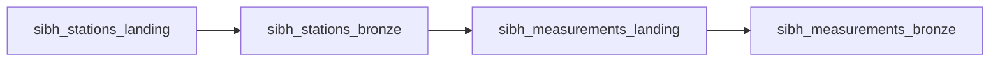

# JOB_CHUVASEGURA_SIBH

## 1. Identificação

| Campo | Valor |
|---|---|
| Identificador | JOB_CHUVASEGURA_SIBH |
| Nome exibido | `ChuvaSegura - SIBH` |
| Arquivo de definição | `jobs/chuvasegura_sibh.job.yml` |
| Responsável técnico | juniorOnData |
| Responsável funcional | A definir |
| Situação | Pausado até o backfill inicial |

## 2. Objetivo

Coletar diariamente o cadastro de estações do SIBH e as medições de chuva e nível dos sensores da capital (exceto CEMADEN) e carregá-los na Bronze.

## 3. Frequência e horário

| Campo | Valor |
|---|---|
| Agenda (Quartz) | `0 30 7 * * ?` |
| Fuso horário | America/Sao_Paulo |
| Horário | Todo dia às 07:30 |
| Situação da agenda | Pausada |
| Fila | Habilitada |

## 4. Tarefas executadas

| Ordem | Tarefa | Notebook | Depende de | Parâmetros |
|---|---|---|---|---|
| 1 | `sibh_stations_landing` | SIB_LND_001 `01_sibh_stations_landing` | Nenhuma | Padrão do notebook |
| 2 | `sibh_stations_bronze` | SIB_BRZ_001 `02_sibh_stations_bronze` | `sibh_stations_landing` | `snapshot_date = pending` |
| 3 | `sibh_measurements_landing` | SIB_LND_002 `03_sibh_measurements_landing` | `sibh_stations_bronze` | `mode = incremental` |
| 4 | `sibh_measurements_bronze` | SIB_BRZ_002 `04_sibh_measurements_bronze` | `sibh_measurements_landing` | `window = pending` |

## 5. Sequência de execução

A sequência é obrigatória: a landing de medições escolhe os sensores a partir do cadastro mais recente na Bronze.

## 6. Políticas de execução

| Política | Configuração |
|---|---|
| Retentativas | Não configurado na tarefa. Os notebooks já repetem chamadas com falha (até 5 por chamada) |
| Timeout | Não configurado |
| Notificações | Não configurado. Recomendação: notificação de falha |
| Compute | Serverless, ambiente 6, `PERFORMANCE_OPTIMIZED` |

## 7. Critérios de sucesso e falha

O job é bem sucedido quando as quatro tarefas terminam sem erro. A landing de medições termina com erro se algum mês falhou (o mês fica sem manifesto e é refeito na próxima execução); a Bronze termina com erro se algum mês não pôde ser carregado.

## 8. Estratégia de reprocessamento

Antes de ativar a agenda, rodar manualmente `03_sibh_measurements_landing` com `mode = backfill` e depois a Bronze com `window = all`. Para testar a API antes de qualquer carga, usar `mode = probe`. Ver [reprocessamento](../04_operacao/reprocessamento.md).

## 9. Histórico

| Data | Responsável | Descrição |
|---|---|---|
| 2026-11-16 | juniorOnData | Criação do job, com a agenda pausada (PR #10) |
| 2026-11-16 | juniorOnData | Documentação no padrão oficial (PR #15) |
